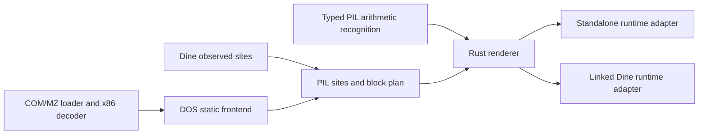

# Compiler reuse boundaries

Implementation review, 10 November 2026. These are current code boundaries;
no second output backend or new guest CPU is claimed.

## Two different kinds of reuse

An output backend (Rust, C, direct LLVM, WebAssembly) can share the validated
guest program and its analyses. A different guest CPU needs its own decoding,
register/flag model and ABI. Existing PIL arithmetic operations are useful for
that frontend, but today's eight 32-bit GPRs, x86 flag names, segment caches and
system effects do not constitute a universal machine-state model.

Compiling the existing portable Rust to another host architecture is already
a separate axis: it uses the same Rust output backend. The x64 assembly probes
do not establish the generated instruction selection or performance on ARM.

## Concrete boundaries in the implementation

| Component | Reusable work | Boundary and remaining coupling |
|---|---|---|
| Validated `Program`/typed PIL tokens in `src/main.rs` | Arithmetic, explicit flags and memory/control effects | The types/parser/executor still need library extraction; some effects and the machine state are x86-specific. |
| `src/pil_opt.rs` | Recognizes carry dataflow and returns typed operand/result IDs, width and add/sub kind | Produces no source text or host instructions. Another renderer can use or decline the idiom. It is not a global flag-liveness pass. |
| `src/dos_translate.rs` | Loads COM/MZ through the existing DOS loader; discovers reachable instructions, validates boundaries, summarizes recursive returns and proves DOS AH services | Returns a `Unit` with loaded state, decoded graph and PIL sites. No Rust rendering. This frontend's admitted instructions/services match the current standalone runtime; another runtime must review that policy. |
| `src/dos_blocks.rs` | Instruction sites, effect profiles, entry hints, primary/alternate block planning, size and effect boundaries | Host/output neutral, shared by observed Dine and static standalone frontends. Guest machine context and flow sizes are retained explicitly. |
| `src/dos_codegen.rs`, `src/rust_codegen.rs`, Rust emitter in `src/main.rs` | Rust instruction/block rendering and portable overflow lowering | Output-backend specific. Rust string bindings and `BlockAdapter` are not a backend-neutral IR. |
| `src/dos_standalone.rs` | Standalone Rust runtime adapter, image initialization, dispatch, retirement, return checks and executable main | Explicit runtime policy. A new backend must reproduce the guest-visible contracts, not copy Rust strings. |
| `src/dos_runtime.rs`, `src/dos_encoding.rs` | Shared DOS output, command tail and CP437/Unicode boundary | Decoder independent, but implemented in Rust. Other generated languages need an ABI/FFI boundary or an implementation of these service contracts. |

The `Unit` and block plan now exist before rendering. Adding MZ uses the same
loader snapshot, relocated instruction bytes and logical entry as COM, rather
than a second decoding or instruction-semantics path. Initial CS/IP, data and
stack segments remain distinct. Generated memory operations resolve live data
segment caches; CS is fixed for this static subset.

## Contracts a new output backend must preserve

- Guest operand widths, subregister writes and the explicit PIL flag formulas,
  including preserved flags and undefined-flag metadata.
- Input snapshots and checked/staged effects: a faulting instruction must not
  commit partial register, memory, flag or control-flow changes. Earlier retired
  instructions in its block remain retired.
- Logical flow and image identity, including near return targets/widths and
  physical code protections. Loaded allocation is not permission to decode BSS.
- Runtime observation boundaries. Linked Dine has budgets, interrupts, traces
  and local changed-code fallback; standalone has a smaller service policy and
  rejects writes to translated code. The same block plan does not erase these
  differences.
- Host I/O and encoding contracts. A block compiler does not independently
  supply DOS files, keyboard, BIOS, protected-mode services or a Telnet transport.

## What should remain deferred

Keep recognition typed and pure, and keep rendered code in backend modules.
Avoid speculative backend frameworks until a second renderer needs one.
The next general foundation is extracting PIL types/validation into a library
and defining a versioned program artifact carrying bindings, control flow and
initial state. Current saved output is Rust; an instruction listing alone is
not yet a reloadable program-level `.pil` representation.

The current tests supply reusable evidence: independent arithmetic results,
interpreter/generated comparisons, precise memory/return faults, recursive
stack restoration, code-write behavior, MZ relocation and live segment checks.
They are acceptance tests a new backend should reuse; x64 assembly patterns
and benchmark numbers are measurements of one host, not semantic requirements.
