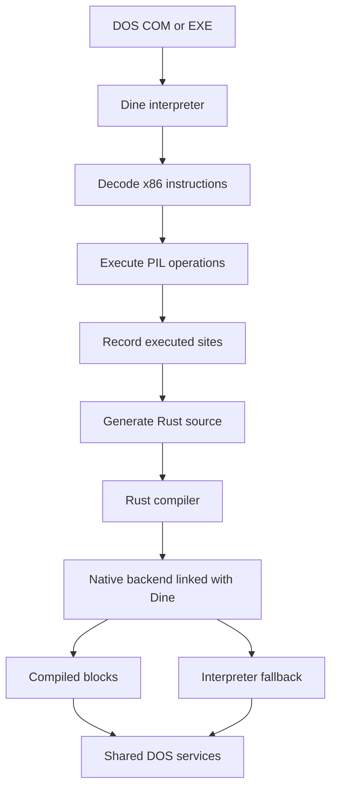
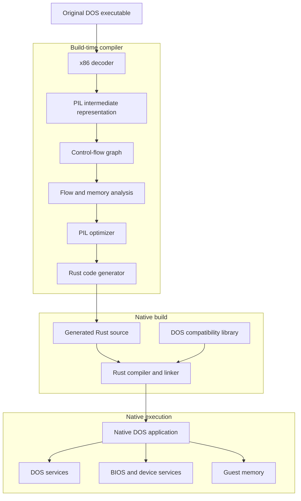
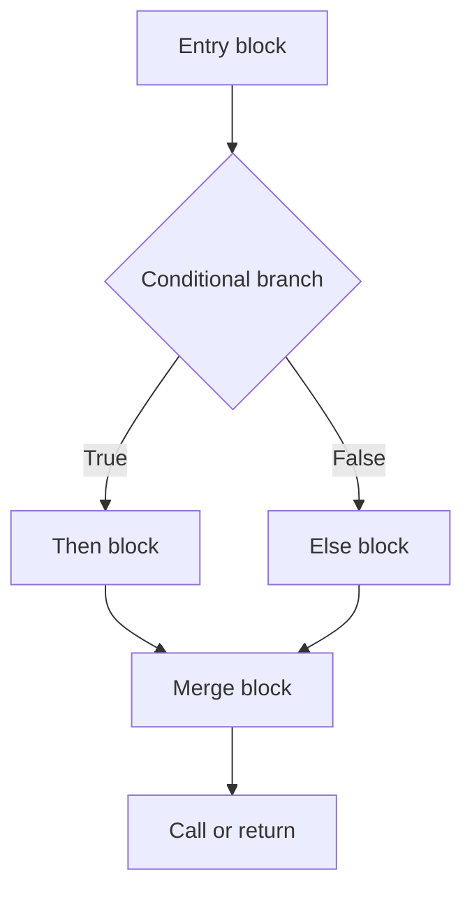
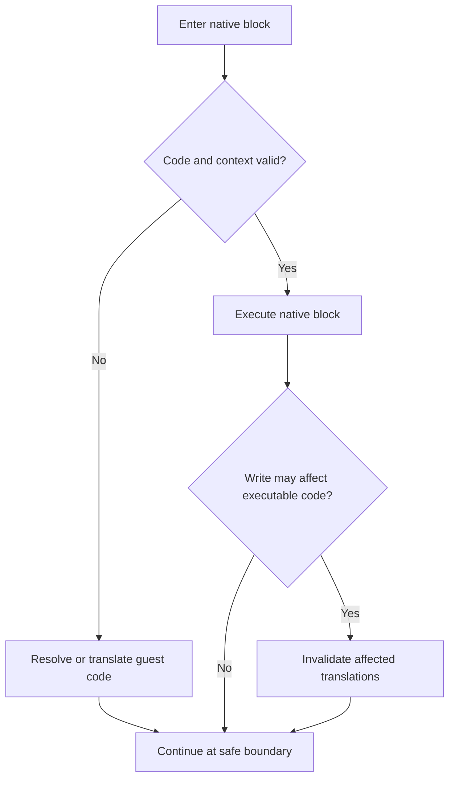
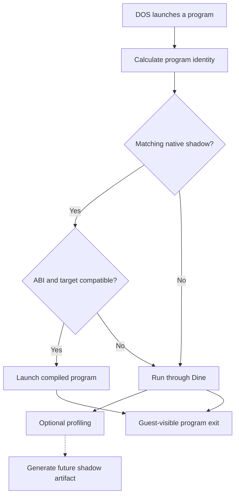

# PILdos Native Compiler Architecture

**Project:** PIL-Processor-Instruction-Language  
**Repository:** `pyTony/PIL-Processor-Instruction-Language`  
**Branch:** `dev`  
**Document version:** 0.1-draft  
**Date:** 2026-11-09  
**Status:** Architecture proposal based on the current implementation

## 1. Purpose

PILdos aims to execute legacy DOS programs through a processor-independent instruction model, with native compilation as the eventual primary execution method.

The long-term objective is to translate complete DOS executables into optimized native host applications.

The compiled application should:

- Execute translated program logic directly as native code.
- Use a reusable DOS compatibility library.
- Avoid repeated x86 decoding.
- Avoid interpreter dispatch during ordinary execution.
- Preserve DOS-visible machine behavior.
- Support Windows, Linux and Android/Termux targets.
- Retain interpreter-based execution for development, profiling and compatibility.

The final architecture separates three concerns:

1. **Translation:** x86 machine code into PIL and native Rust.
2. **Execution:** optimized native program code.
3. **Compatibility:** DOS, BIOS, memory, graphics and I/O services.

The existing interpreter remains a reference implementation and can serve as a development fallback. It should not be a required component of a fully compiled program.

## 2. Current implementation

### 2.1 Verified source-level capabilities

The `dev` branch currently contains `src/dos_compile.rs` and the experimental native compilation workflow documented in `docs/DOS_NATIVE.md`.

Current capabilities include:

| Component | Current status |
|---|---|
| x86 instruction decoding | Implemented |
| PIL instruction representation | Implemented |
| Rust generation from PIL | Implemented |
| Execution-site profiling | Implemented |
| Native instruction helpers | Implemented |
| Native blocks up to 16 instructions | Implemented |
| Shared block planning/emission for Dine and standalone | Implemented; local Windows verified |
| Block-entry validity checks | Implemented |
| Interpreter fallback | Implemented |
| Executable identity checks | Implemented |
| Shadow output directory | Implemented |
| Native block statistics | Implemented |
| Independent standalone DOS library | Not established |
| Linear register-only COM with AH09/AH4C/INT20, no interpreter | Implemented; local Windows verified |
| Register-only COM direct branches and loops, no interpreter | Implemented; local Windows verified |
| Ordinary addressed RAM reads in standalone COM | Implemented; local Windows verified |
| Ordinary addressed RAM stores/RMW, protected translated code | Implemented; local Windows verified |
| Register/immediate PUSH, register POP, direct near CALL/RET | Implemented; local Windows verified |
| Standalone PSP command-line input and AH02 character output | Implemented; local Windows verified |
| General DOS program compiled without interpreter fallback | Not established |
| Automatic shadow selection in every ordinary DOS launch | Not established |
| Full control-flow graph compilation | Planned |
| Cross-block native execution | Planned |

These statuses describe the reviewed source and documentation, not a fresh complete runtime test.

### 2.2 Current compilation process

The existing generator observes execution rather than statically translating all executable bytes.



Current implementation characteristics:

- Up to 65,536 distinct instruction offsets are recorded.
- Profiling continues through bounded execution slices.
- Only executed instruction sites are compiled.
- Generated Rust is linked into the Dine engine.
- Multiple instructions may execute as one compiled block.
- Unseen or changed instructions return to interpreter execution.
- Program identity, machine state and instruction bytes are checked before entering compiled blocks.

The present system is a useful correctness foundation, but it is not yet the final native compiler.

## 3. Target architecture

The proposed architecture introduces a clean separation between the compiler, generated program and DOS runtime.



The generated executable contains translated program logic and links against the compatibility runtime.

The runtime must not require the original x86 decoder or interpreter for fully supported programs.

### 3.1 Architectural boundaries

| Layer | Responsibility |
|---|---|
| x86 decoder | Interpret original instruction bytes |
| PIL IR | Represent instruction semantics independently of host CPU |
| CFG builder | Discover control-flow relationships |
| Optimizer | Simplify and combine PIL operations |
| Rust backend | Generate native source |
| DOS runtime | Provide DOS-compatible services |
| Device layer | Provide video, keyboard, timer, serial and other device behavior |
| Launcher | Select compiled application or interpreter |
| Verification framework | Compare translated and interpreted execution |

The compiler should depend on the PIL semantic model, not on the interpreter's dispatch mechanism.

The runtime should expose explicit services and machine-state operations.

## 4. Compilation pipeline

### 4.1 Phase A: executable loading

Supported input formats initially include DOS `.COM` and MZ `.EXE`.

The loader must preserve:

- Executable identity and content hash.
- Entry point.
- Segment layout.
- Initial registers and stack.
- Program Segment Prefix (PSP).
- Relocation information.
- DOS command-line arguments.
- Execution environment.

The compiler must understand the loading conventions rather than treating every executable as a flat binary.

### 4.2 Phase B: instruction discovery

The current profiler is the first source of valid instruction boundaries.

The next design should combine:

1. Observed instruction addresses from execution.
2. Recursive discovery of statically resolvable branches.
3. Control-flow targets inferred from tables when provable.
4. Additional profiles from different inputs.

Uncertain data regions must never automatically be interpreted as executable code.

A distinction is required between:

- Confirmed instruction starts.
- Potential instruction starts.
- Unknown regions.
- Known data.
- Dynamically generated code.

A translation is valid only when the assumed instruction bytes and machine context remain valid.

### 4.3 Phase C: PIL intermediate representation

PIL should become the stable interface between processor semantics and native code generation.

Each operation should explicitly describe:

- Register inputs and outputs.
- Memory reads and writes.
- Flag dependencies.
- Segment dependencies.
- Control-flow effects.
- Possible faults.
- Side effects and service boundaries.

Example conceptual representation:

```text
LOAD AX, 5
ADD AX, 3
STORE BX, AX
```

The actual generator must use the project's existing PIL semantics rather than inventing a second instruction language.

### 4.4 Phase D: control-flow graph

Basic blocks are discovered using instruction boundaries and control-flow transfers.



A basic block has one entry and no internal control-flow transfer except at its terminator.

The current 16-instruction bound is a conservative implementation limit, not a permanent architectural constraint.

Future blocks may contain more instructions when correctness and optimization justify it.

A branch to an address inside an existing block must be supported by creating a valid entry point there or by splitting the block. The compiler must never enter arbitrary host machine code in the middle of a generated native block.

### 4.5 Phase E: optimization

Optimizations must operate on PIL semantics.

Initial priorities:

- Constant propagation.
- Dead temporary elimination.
- Common subexpression elimination where safe.
- Register-value reuse.
- Lazy flag evaluation.
- Removal of flag calculations whose results are overwritten before use.
- Combining adjacent operations.
- Eliminating redundant memory address calculations.
- Direct native branches between compiled blocks.

Later optimizations may include:

- Loop-invariant code motion.
- Function specialization.
- Native register allocation.
- Profile-guided block layout.
- Whole-function optimization.
- Selective native SIMD.

Flag optimization needs particular care. x86 instructions may update only a subset of status flags, and undefined flags must retain the project's defined compatibility policy.

Memory, device and exception side effects must not be reordered across observable boundaries.

## 5. Atomic native blocks

### 5.1 Proposed execution contract

A native block should have:

- A known guest entry address.
- A validated guest machine context.
- An instruction-byte identity or equivalent validity guarantee.
- A predictable exit contract.
- Explicit reporting of faults and execution counts.

The block may execute directly without redecoding each instruction.

It must stop when a boundary makes continued execution unsafe.

Typical boundaries include:

- Control-flow transfers whose target is unresolved.
- DOS or BIOS service calls.
- Privilege or processor mode changes.
- Writes that can modify executable code.
- Operations requiring external device synchronization.
- Page mapping or segmentation changes.
- Instruction-budget and debugging boundaries when enabled.

### 5.2 Self-modifying code

A guest program can modify instructions after translation.

The compiler and runtime therefore need an invalidation strategy.



**Recommended policy:** maintain versioned executable memory regions or pages, with exact byte checks where needed.

For correctness, a write to potentially executable memory must invalidate all translations that depend on those bytes before they execute again.

If a store affects code later in the same compiled sequence, the sequence must terminate before the changed instruction is executed.

Version counters are an optimization of the validity test, not a replacement for correct invalidation.

### 5.3 Atomicity

Atomicity should mean a safe compiler scheduling and dispatch unit.

It must not hide architecturally visible exceptions, interrupts or partial progress.

A faulting block must preserve the effects of retired instructions and report the faulting guest instruction precisely.

For features requiring instruction-level observation, the compiler should provide finer-grained execution checkpoints.

## 6. DOS runtime library

The long-term runtime should be a separately buildable Rust library.

Proposed name: `pildos_runtime`.

Its purpose is to implement guest-visible DOS and machine services, without requiring an x86 instruction interpreter.

### 6.1 Runtime modules

Proposed logical structure:

```text
pildos_runtime/
    cpu_state
    memory
    segmentation
    interrupts
    dos/
        process
        filesystem
        console
        environment
        handles
        memory_management
    bios/
        video
        keyboard
        disk
        timer
    devices/
        vga
        pic
        pit
        rtc
        serial
    frontend/
        headless
        graphical
```

This is a proposed modular boundary. Existing `src/dos_*.rs`, `src/dos.rs`, `src/address.rs` and related modules should be reused and extracted incrementally, not rewritten wholesale.

### 6.2 DOS runtime interfaces

The generated program should interact with the runtime through structured calls.

A conceptual Rust API:

```rust
pub struct GuestContext {
    pub cpu: CpuState,
    pub memory: GuestMemory,
    pub machine: MachineState,
    pub dos: DosProcessState,
}

pub enum GuestEvent {
    Continue,
    Interrupt(u8),
    IoRequest,
    WaitForInput,
    Exit(u8),
    Fault(GuestFault),
}

pub trait DosRuntime {
    fn interrupt(
        &mut self,
        vector: u8,
        context: &mut GuestContext,
    ) -> GuestEvent;

    fn io_read(
        &mut self,
        port: u16,
        width: u8,
    ) -> Result<u32, GuestFault>;

    fn io_write(
        &mut self,
        port: u16,
        width: u8,
        value: u32,
    ) -> Result<(), GuestFault>;
}
```

This is illustrative, not an existing API specification.

The final implementation must also address borrow ownership, asynchronous host I/O, instruction retirement, interrupt delivery and reentrancy.

### 6.3 Service compatibility

The library must preserve register-level DOS and BIOS calling conventions.

Priority services include:

| Interface | Priority |
|---|---|
| INT 21h process and console services | Critical |
| INT 21h file and directory services | Critical |
| DOS memory allocation | Critical |
| PSP and environment management | Critical |
| EXEC and program termination | Critical |
| INT 10h video | High |
| INT 16h keyboard | High |
| INT 1Ah clock | High |
| INT 13h disk | High |
| VGA memory and ports | High |
| Serial and printer | Medium |
| 80387 FPU | Separate replaceable module |

The runtime should reuse the existing service implementations wherever possible.

An unsupported service must return a documented error or unsupported-operation result rather than silently pretending to succeed.

## 7. Guest memory model

Compiled code cannot simply treat guest addresses as unrestricted host pointers.

The guest memory layer must reproduce:

- Real-mode segment calculations.
- A20 behavior.
- Protected-mode segmentation.
- Paging when enabled.
- Access permissions.
- Unaligned accesses.
- Memory-mapped video.
- Fault conditions.

The compiler can optimize guest memory access when it proves the relevant conditions remain valid.

A fast path may use checked direct memory access under a stable machine context.

Otherwise it must use the compatibility memory API.

The same logical memory model should be shared by interpreted and compiled execution to prevent compatibility divergence.

## 8. Native executable and shadow selection

### 8.1 Intended behavior

The compiler stores generated applications outside the original DOS drive.

Original DOS files remain unchanged.

A normal PILdos launch checks whether a matching compiled application exists.



The exact integration of an ordinary DOS `EXEC` call with the native launcher remains future work.

### 8.2 Artifact organization

Proposed arrangement:

```text
shadow/
    windows-x86_64/
        <guest_sha256>/
            manifest.json
            backend.rs
            native.exe

    linux-x86_64/
        <guest_sha256>/
            manifest.json
            backend.rs
            native

    linux-aarch64/
        <guest_sha256>/
            manifest.json
            backend.rs
            native
```

The current helper already records target and compiler metadata under target-specific shadow paths.

A stable runtime ABI must be added before standalone binaries can be reused safely across runtime versions.

### 8.3 Cache manifest

Proposed fields:

```json
{
  "schema": 1,
  "guest_sha256": "<sha256>",
  "guest_format": "COM",
  "target_triple": "x86_64-pc-windows-msvc",
  "compiler_version": "<version>",
  "pil_semantics_version": "<version>",
  "runtime_abi_version": "<version>",
  "translation_mode": "profile-guided",
  "coverage": "partial",
  "backend_sha256": "<sha256>",
  "binary_sha256": "<sha256>"
}
```

The loader must reject incompatible artifacts.

Guest file identity alone is not enough: generated code may also depend on the PIL semantic version, compiler behavior and runtime ABI.

The launcher must never execute untrusted generated artifacts solely because their filenames match.

### 8.4 Two distinct native modes

The project should explicitly distinguish:

**Native-assisted mode**

- Generated code is linked with Dine.
- Unknown instructions fall back to interpretation.
- Useful during incremental translation and verification.

**Standalone-native mode**

- Generated code links against the DOS runtime only.
- No x86 interpreter is linked.
- Translation coverage is complete for the supported execution paths.
- Unsupported dynamic code is reported explicitly.

This distinction should appear in documentation, command-line diagnostics and performance reports.

## 9. Dynamic execution and late compilation

A complete DOS program can contain indirect branches, overlays, generated code and dynamically loaded modules.

The static compiler therefore cannot assume every reachable instruction is known in advance.

The recommended strategy is:

1. Compile all reliably discovered regions.
2. Track uncertain and dynamically discovered regions.
3. Retain profile information between runs.
4. Generate new translations when sufficient information becomes available.
5. Rebuild a new artifact with expanded coverage.
6. Never silently execute unknown x86 code in standalone mode.

Background profile-guided compilation may eventually create new artifacts without blocking an interactive DOS session, but this is an optional optimization, not a correctness requirement.

## 10. DOS configuration

The present `pildos.conf` format supplies the initial configuration foundation.

Relevant existing settings include:

```ini
program=images/FD14LITE.img::COMMAND.COM
args=/K D:\AUTOEXEC.BAT
C=images/FD14LITE.img
D=driveD
country=358
```

The native runtime should use the same configuration interpretation as the interpreter.

Important compatibility requirements:

- Directory-backed drives remain writable according to configuration.
- FAT image mounts retain the documented access restrictions.
- Multiple drive letters work consistently.
- The temporary Z drive remains session-local.
- Country and environment settings remain compatible.
- Relative paths resolve against the configuration file directory.
- Windows, Linux and Termux launchers follow equivalent rules.

A compiled program must not embed developer-specific mount paths.

DOS drive letters must be resolved through runtime services, not directly converted into host filesystem paths by generated application code.

## 11. Verification strategy

Correctness has priority over benchmark speed.

### 11.1 Differential execution

The existing interpreter is the behavioral reference.

Tests should compare:

- Register state.
- Defined and tracked undefined flag state.
- Guest memory.
- Segment and machine state.
- DOS process state.
- File-system effects.
- Console output.
- VGA planes and palette.
- Interrupt behavior.
- Exit status.
- Fault location and partial execution.

Exact guest instruction counts should be compared where the execution model specifies them. Native host instruction counts are not expected to match.

### 11.2 Tests for control-flow behavior

Required cases:

1. Jump to a compiled block entry.
2. Jump to an interior guest instruction boundary.
3. Conditional branch taken and not taken.
4. Nested calls and returns.
5. Indirect jump through registers or memory.
6. Code modification followed by re-execution.
7. Segment change before a compiled block.
8. Fault in the middle of a compiled block.
9. Interrupt between instructions.
10. Execution-budget exhaustion within a block.

### 11.3 DOS application test suite

| Program | Primary test |
|---|---|
| HELLO.COM | Console output and termination |
| FACTOR.COM | Arithmetic and control flow |
| GREP.COM | Arguments, files and text processing |
| MANDVGA.COM | Graphics and optimized loops |
| FreeCOM | DOS shell, EXEC and environment |
| GW-BASIC | Interpreter workload and DOS services |
| BBC BASIC 86 | Arithmetic, graphics and dynamic machine code |
| Landmark | Timing, BIOS, CPU and video behavior |

Each test must record whether it ran interpreted, native-assisted or standalone-native.

A successful execution in native-assisted mode is not proof that standalone compilation is complete.

## 12. Performance measurements

Performance testing should distinguish three categories:

**CPU execution throughput:** guest instructions executed per second.

**Application elapsed time:** time required to complete a real workload.

**Native coverage:** proportion of executed guest instructions handled by generated native blocks.

Compilation time must be reported separately from execution time.

Recommended benchmark report:

```text
Program:
Guest SHA256:
Host OS and CPU:
Compiler version:
Runtime ABI:
Execution mode:
Input and configuration:
Guest instructions:
Native block instructions:
Interpreter fallback instructions:
Native coverage:
Elapsed time:
Output verification:
Speed ratio:
```

The current native block counters measure multi-instruction blocks. They should not be mistaken for total compiled coverage, because single-instruction native operations may be excluded.

Benchmark comparisons must use equivalent input, graphics configuration and termination conditions.

Landmark-style emulated clock-speed estimates should be reported separately from measured wall-clock execution times.

## 13. Implementation milestones

### Milestone 1: Stable native-assisted backend

**Objective:** make the present compiler reliable and measurable.

Deliverables:

- Reproducible generated Rust source.
- Explicit machine-context guards.
- Correct invalidation.
- Differential tests.
- Block and fallback statistics.

Acceptance: generated and interpreted execution agree on representative workloads.

### Milestone 2: Extract DOS runtime interfaces

**Objective:** separate guest services from interpreter implementation.

Deliverables:

- Reusable runtime API.
- Machine-state ownership model.
- File, console, memory and process services.
- Shared configuration implementation.

Acceptance: interpreter and generated code invoke the same service implementations.

### Milestone 3: Standalone HELLO.COM

**Objective:** execute the first translated DOS program without linking Dine.

Deliverables:

- Native application executable.
- Runtime-only linking.
- Correct console output.
- Correct exit code.
- No interpreter or x86 decoder dependency.

Acceptance: the executable runs independently with only the compiled runtime and required host libraries.

### Milestone 4: Standalone computational programs

**Objective:** extend direct native control flow beyond simple linear programs.

Deliverables:

- Native branches and loops.
- Calls and returns.
- Memory access fast paths.
- Full translation coverage reports.

Acceptance: arithmetic and Mandelbrot-style computational workloads match reference results.

### Milestone 5: DOS application compatibility

**Objective:** support real applications and the DOS shell environment.

Deliverables:

- Program launching.
- DOS files and handles.
- Environment inheritance.
- Multiple drives.
- Console and keyboard support.
- Graphics compatibility.

Acceptance: representative programs run correctly from an ordinary configured DOS environment.

### Milestone 6: Native shadow integration

**Objective:** automatically select valid compiled applications.

Deliverables:

- Runtime ABI versioning.
- Secure artifact selection.
- Compatible launcher.
- Explicit fallback policies.
- Cache invalidation and diagnostics.

Acceptance: ordinary PILdos launches select valid native artifacts without modifying original DOS files.

### Milestone 7: Advanced execution

**Objective:** improve coverage and performance while expanding processor compatibility.

Potential work:

- Protected-mode applications.
- Paging-aware native execution.
- Overlay handling.
- Late code discovery.
- 80387 module integration.
- Whole-function optimization.
- Profile-guided native compilation.

## 14. Architectural decisions

| Decision | Recommendation |
|---|---|
| Primary intermediate language | PIL |
| Native generation language | Rust |
| Interpreter retained | Yes, as reference and fallback |
| Standalone compiled binaries | Primary long-term goal |
| DOS runtime | Independent reusable library |
| Original guest files | Never modified by compilation |
| Shadow identity | Content hash plus compiler/runtime compatibility |
| Self-modifying code | Explicit invalidation |
| Instruction discovery | Profile-guided plus conservative static analysis |
| Graphics implementation | Reuse existing DOS/VGA services |
| 80387 | Separate replaceable module |
| Host platforms | Windows, Linux, Android/Termux |
| Verification | Differential execution against Dine |

## 15. Open questions

The following decisions require further design or implementation evidence.

**Runtime ownership:** Should each standalone executable contain a statically linked DOS runtime, or should the runtime be provided as a shared library with a stable ABI?

**Program launching:** How should a translated DOS process invoke another program, especially when the child exists only as original x86 code?

**Memory ownership:** Should a translated program own one guest address space, or should a supervising DOS session retain ownership?

**Dynamic code:** What should happen when a standalone program reaches an unknown generated instruction sequence?

**Threading:** Which parts of I/O and compilation may run concurrently without changing guest-visible timing or memory semantics?

**Debugging:** How should generated Rust map back to guest CS:IP, original source locations and PIL operations?

**Native coverage:** What minimum information must the compiler prove before labeling an artifact standalone-native?

**Compatibility versioning:** Which changes invalidate previously compiled artifacts?

## 16. Recommended immediate next task

The initial runtime extraction enabling a standalone HELLO.COM is implemented
by `src/dos_standalone.rs` and `src/dos_runtime.rs`. The generated self-contained
Rust source uses the existing PIL emitter and shared memory/segment types,
without including the guest decoder, token interpreter or DOS loader. The
runtime's bounded AH09 string validation is shared with Dine. It remains a
small embedded module rather than an independently packaged runtime crate.

`tools/verify_dos_standalone.py` verifies 49 applications against Dine on
Windows, builds them directly with rustc, and runs them after removing the COM
and generated Rust files. Windows/Linux CI now includes that verification;
hosted results are pending. The supported subset and commands are documented
in `docs/DOS_NATIVE.md`.

An initial conservative direct-branch discovery pass now compiles a restricted
register-only COM graph with INT20 and restricted INT21/AH09 and AH4C calls.
It checks both conditional paths, rejects overlapping instructions and
unsupported reachable operations, and emits native dispatch without a decoder.
PIL writes establish or invalidate known AH constants; every INT21 incoming
path must prove AH09 or AH4C. The analysis preserves known AH across branches
and AL-only writes. Discovery handles direct short/near JMP, all 16 Jcc
conditions, LOOP/LOOPE/LOOPNE and JCXZ/JECXZ, respecting operand/address size.
It is bounded to 4096 instruction sites and 65,536 service-analysis states.
There is now one graph-based emitter instead of a separate linear simulation
fallback. All Jcc conditions taken/untaken, loop results and branch-size cases
are compared with Dine on Windows. No hosted CI result is claimed here.

Ordinary memory reads now retain their decoded AddressContext and use the same
PIL `read_address`/`load` effects and Rust `execute_with_machine` wrapper as Dine.
The compiler only classifies supported effects; it does not implement new
instruction semantics. Loads and read-only arithmetic operands support mixed
operand/address sizes, moffs, SIB, overrides and 16-bit EA wrapping. The emitted
initial context preserves A20. Eight tests compiled into generated Rust check
precise faults and state preservation, live SS/FS caches, segment-end and
read-only RAM reads, and A20 wrapping. Ordinary addressed stores and RMW now
reuse the shared PIL Store/StoreIf effects and Rust generator. The initialized
RAM retains original read-only spans; all translated instruction bytes are
additionally protected, with only adjacent code bytes merged into spans.
Seven generated store tests cover faults, aliases, partial overlap, ROM/code
protection, RMW/XCHG atomicity and the existing zero-count shift store checks. Any actual
write touching translated code, including an explicit same-value write, is a
runtime error; self-modifying code remains unsupported in standalone artifacts.
Register/immediate PUSH, register POP and direct near CALL/RET now reuse existing
PIL effects. Call-context discovery is bounded to 32 nested calls and tracks
AH through callees. Runtime return-site metadata rejects rewritten/unproven
returns without committing register/IP/SP effects. Five generated tests cover
CALL/RET16/32, stack faults, code overlap and return-target rejection. Indirect
control flow, far transfers, recursion and other stack/string forms remain
excluded.

For linked pil.exe, the user chose allowing code writes with local interpreter
fallback. The watched-page cache uses its unchanged-code shortcut only until
the first successful write, then retains byte validation. Native block guards
reject changed sites while unchanged regions remain native eligible. The
standalone artifacts still protect code because they contain no interpreter.
`tools/verify_dos_smc.py` checks this distinction using a self-modifying fixture
and a separately linked generated backend.

Standalone programs now receive host arguments through the shared Dine PSP
command-tail writer: Unicode encoded as CP437, up to 125 DOS bytes, with normal DOS
length/leading-space/CR layout. Twelve argument cases are compared with Dine;
invalid input fails before execution. AH02 character output shares Dine's
console-byte/tab planning helper, complementing existing AH09 string output.
The existing PIL decoder and Rust instruction generator remain unchanged.

## 17. Shared compiler modules and optimization audit — 10 November 2026

The module review separated shared generation from discovery and runtime policy:

| Module | Responsibility |
|---|---|
| `src/dos_codegen.rs` | Shared Site/Profile, conservative block plan, instruction-module/call emission, generic block emitter |
| `src/dos_compile.rs` | Profiled discovery, executable/code/context guards, Dine block adapter and fallback contract |
| `src/dos_standalone.rs` | Static COM graph discovery, supported-subset checks, initialization/protection and standalone block adapter |
| `src/dos_runtime.rs` | Small DOS service contracts, shared output/tail helpers and standalone state |
| `src/dos_encoding.rs` | Host Unicode to guest CP437 and CP437 to UTF-8/raw output |

Shared generation has no loader/session dependency. Neither runtime owns a
separate block algorithm or instruction-semantics implementation. The core PIL
types/parser/executor/Rust emitter remain together in the existing 2700-line
`main.rs`; extracting that core into a library is still a modularity opportunity.
This change does not claim a fully independent packaged DOS runtime.

Standalone production execution now dispatches the same bounded block plans as
Dine; per-instruction execution is emitted only for verification. Both retain
their own retirement/fault contracts. The generated prefix-fault test verifies
that three retired instructions remain committed when the fourth faults.

`tools/audit_dos_codegen.py` emits LLVM IR/assembly and liveness probes using
the real PIL-to-Rust emitter. Local x64 Rust 1.99.1, `-O -Ccodegen-units=1`:

| Probe | Optimized parity/popcount sites | Observation |
|---|---:|---|
| One ADD, full final flags observable | 1 | Final flags retained |
| Eight ADDs, full final flags observable | 1 | Intermediate parity work removed; arithmetic also combined |
| ADD then ADC | 1 | First carry dependency retained; assembly uses native ADD/ADC |
| ADD then INC | 1 | First CF retained; other overwritten flag work removed |
| ADD then JE, only branch/result observable | 0 | Only the required condition remains |
| ADD then JG, only branch/result observable | 0 | No parity work remains |

The x64 backend lowers parity to host parity-flag operations (`testb`/`setnp`),
not necessarily a hardware POPCNT instruction. Static LLVM intrinsic counts
are not dynamic counts or cycle costs. Native flags are already used where
LLVM recognizes the dependency; packing guest-visible FLAGS still costs work.
Arbitrary Rust calls/instructions cannot be assumed to preserve host flags.
Fault/debug/service boundaries and guest operand widths constrain elimination.

For ANSI Mandelbrot, out-of-line instruction helpers fell from 47 to zero and
52 block functions remain. Static LLVM parity sites grew from 12 to 22 because
entry suffixes are duplicated. The executable grew from 506368 to 540672 bytes
(about 6.8%); these are whole generated builds, including runtime changes.
This identifies block-entry duplication and cross-block flag liveness as
remaining opportunities, rather than claiming all flags are optimized away.

An in-process comparison ran 100 complete frames per sample, six alternating
samples per build, discarding the first sample per build. No terminal output;
RAM initialization/runtime setup included. Median before: 12.094 ms/frame;
shared blocks: 8.604 ms/frame, about 1.41x or 29% less time. This excludes
process startup and is not an isolated flag-only benchmark. Reproduce with
`tools/audit_dos_codegen.py --program programs/dos/MANDANSI.COM --baseline SAVED_SOURCE.rs --benchmark`; results,
IR and assembly are saved under `target/compiler-optimization-audit/`.

The standalone output adapter defaults to UTF-8, with `PIL_DOS_RAW_OUTPUT=1`
for raw CP437 terminals. Telnet framing remains the transport's responsibility;
the encoding module does not implement a Telnet server.

### Block-entry deduplication — 10 November 2026

`dos_codegen::BlockPlan` now partitions primary blocks and keeps a single
instruction at each interior alternate entry, instead of compiling every full
suffix. Leaders include direct targets, continuations, context/store boundaries
and Dine's observed control-transfer entries, including indirect targets.
The profiler updates entry observations on revisits as well as new sites.
Plan membership, sequence length, emission and guard spans use one plan.

The 16-instruction bound, partial-instruction exclusion and context boundaries
remain in place. An alternate entry executes one instruction and returns to
dispatch; Dine's ordinary single-site fallback remains available when a primary
block does not fit the budget. A fault retains previously retired instructions.
Generated guard tests check small budgets and local self-modification fallback;
standalone tests additionally exercise an interior entry followed by a fault.

ANSI Mandelbrot, same audit flags: 22 primary blocks and 30 alternates preserve
52 entries, while emitted instruction bodies fall from 134 to 82. Generated
LLVM instruction lines fall from 14971 to 10267, and executable size from
540672 to 517632 bytes. These are static size counts, not dynamic work.
Six alternating 100-frame samples, discarding each first sample, measured
8.632 versus 8.448 ms/frame within process with no terminal output. The small
timing difference lies within the sample spread; this phase demonstrates a
size reduction, not a claimed substantial speedup. Audit artifacts are in
`target/compiler-entry-current-audit/` and include `entry-benchmark.json`.

The normal debug `pil.exe` was in use during validation. The current test engine
was built with `cargo build --locked --target-dir target/block-entry-build`;
all new CLI checks explicitly selected that engine. The earlier test run using
the old locked executable is discarded. No running user process was stopped.

Next: expand supported services (input/files) and stack forms, preserving
existing PIL effects, fault atomicity and control-flow validation.

The original MANDANSI.COM now exercises the current compiler end to end:
79x24 ANSI-coloured Mandelbrot, signed 8.8 arithmetic, IMUL, loops, memory,
near calls and DOS output. It compiles without changes to instruction rules.
`tools/verify_ansi_mandel.py` checks all 1896 coloured glyphs and the complete
ANSI stream against Dine and a separate Python arithmetic oracle. The original
COM and NASM source are reproducibly generated by `tools/build_ansi_mandel.py`.
Windows validation is local; Windows/Linux CI is configured, not yet claimed.

Acceptance criteria for the completed initial proof:

1. Define an independent guest execution context.
2. Extract the console-output and process-exit service boundaries.
3. Generate a Rust program using those interfaces.
4. Link it without the x86 interpreter.
5. Compare its output and termination against interpreted HELLO.COM.
6. Verify that the generated executable contains no dependency on the interpreter or decoder.

This milestone provides a concrete architectural proof that the compiler can produce complete native applications rather than merely optimized interpreter backends.

Once established, additional DOS services and increasingly complex compiled programs can use the same foundation.

---

**Document status:** Proposed design. Implementation details and acceptance results must be updated alongside code changes.

**Related files:**

- `docs/DOS_NATIVE.md`
- `docs/DOS_CONFIG.md`
- `src/dos_compile.rs`
- `src/dos.rs`
- `src/dos_services.rs`
- `src/dos_session.rs`
- `src/guest.rs`
- `src/native.rs`

**Suggested document path:** `docs/development/NATIVE_DOS_ARCHITECTURE.md`
